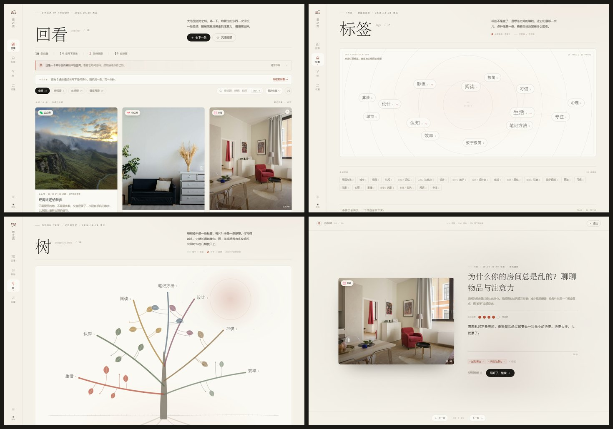
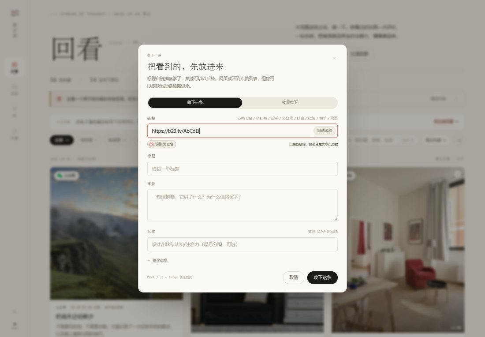

# 思之流 · Stream of Thought

> 通过不断地评价、回顾、思考，打断被信息流劫持的大脑，更容易看清自己，而不是被 BGM 推着大脑走。



一个本地优先的「信息流回顾」网页。把看过的视频、帖子、文章收进来，给它们一个评价、一句感想、几个标签，然后通过检索、标签星图与记忆树，重新看见自己反复被什么吸引。

---

## 快速开始

**推荐方式：双击 `启动.cmd`**

它会在本机启动一个只监听 `127.0.0.1` 的静态服务器，并自动打开浏览器。使用 `localhost` 打开，浏览器才会允许「选择本地数据文件夹」等能力。

也可以直接用浏览器打开 `index.html`（双击即可）。页面、素材、数据都在本地，不依赖构建工具；只是某些浏览器在 `file://` 下会限制文件夹访问，此时仍会把数据保存在浏览器本地数据库里。

如果 Node.js 不可用，`启动.cmd` 会退回到 Python 自带的静态服务器。

**建议浏览器**：Chrome / Edge（较新版本）。Safari、Firefox 也可以使用核心功能，但「选择数据文件夹」可能不可用。

---

## 它对应了原文档的哪些要求

| 原文档 | 这里的样子 |
| --- | --- |
| 抓取账号点赞视频、点赞时间、快速总结 | 提供「粘贴链接 / 批量粘贴 / 浏览器采集器」三条通路；点赞时间可以随批量行一起带入。自动抓取与自动摘要需要平台接口或模型 Key，详见下文边界说明。 |
| 每个视频是一个小模块，封面、标题可复制、超链接到原处 | 瀑布流卡片：来源、收藏时间、作者、封面、时长；「复制标题」与「原链接」。 |
| 模块可变为正方块、长方块，随页面大小与展开变化 | 每张卡按内容拥有 1:1 / 4:5 / 16:10 的封面比例；展开后封面变为 16:10 并让出正文区域，窄屏自动单列。 |
| 每个视频下面的回顾区、评价栏、感想 | 5 点评分（浪费了 / 翻过 / 还行 / 有收获 / 击中我）+ 自动保存的感想输入框。 |
| 关键词检索（标题、感想、标签） | 顶部搜索实时过滤，支持多关键词、与筛选叠加，`Ctrl / ⌘ K` 呼出全局检索与跳转。 |
| 标签、附标签（父/子） | 用 `父/子` 写法，如 `设计/排版`；标签星图里父标签带 `+N` 子标签提示，点进去可继续选子标签。 |
| 独立标签页，标签悬浮，点进去看感想 | 「标签」页是一张会缓慢漂移的标签星图；选中后，下方是与此标签（含子标签）相连的所有感想。 |
| 个人主页：一棵树，枝干是标签，枝条是感想 | 「树」页：桌面端是一棵用 SVG 手绘生长的树，叶子可点开；移动端自动变成树干式清单，保证可读。 |
| 从小红书 / B站 / 公众号 / 知乎等平台复制链接加入 | 直接粘贴整段分享文字即可：自动提取链接、忽略配文与乱码；来源会显示对应平台图标。也支持批量粘贴与采集器 JSON。 |
| 数据存储在本地文件夹（可更改） | 默认 IndexedDB；设置里可连接任意本地文件夹，自动写入可读的 `sizhiliu.json`，可随时更换 / 断开 / 手动写入。 |
| 简洁、美观、流畅动画 | 暖纸与墨色两套主题；宋体标题、等宽标注、细腻的过渡与 FLIP 重排；标签星图、树生长、沉浸回顾。 |
| 低耦合、高鲁棒、减少屎山 | 纯静态、无框架、无构建；核心状态 / 存储适配器 / 纯函数服务 / 视图分层，单文件单职责，详见「架构」。 |

### 关于「抓取点赞」与「快速总结」的真实边界

这是一个纯前端网页，没有服务器，也没有你的平台登录态。因此它**不能直接读取**你在 B 站 / 小红书 / 知乎 / 抖音里的点赞列表，也无法在没有模型 Key 的情况下替你生成摘要。

当前提供了三条确实可用的替代路径：

1. **收下一条**：直接粘贴整段分享文字，会自动提取链接、忽略配文与乱码；再手动补标题与摘要。
2. **批量收下**：从点赞列表复制链接，一行一条；可以写成 `标题 | 链接 | 2026-10-01`，把点赞日期一起带进来；也接受采集器输出的 JSON。整段分享文字同样能识别出链接。
3. **浏览器采集器**：设置页「怎么收下内容」里的书签按钮。拖到书签栏，在平台收藏页点一下，会抓取当前页可见的内容链接并复制成 JSON，回到「批量收下」粘贴即可。

摘要字段是留给「你自己的快速总结」的，这恰好也是产品哲学的一部分：不是让算法替你消化，而是用一次复述把熟悉感变成记忆。如果之后要接自动摘要，可以在 `js/services/metadata.js` 旁边增加一个模型服务，把结果写进 `summary`，其余界面无需改动。

---

## 功能地图

### 回看

- 16 条示例内容，按最近收藏排序；可按「待回看 / 有感想 / 值得再看」筛选，按评分或回看时间排序。
- 点卡片标题或「展开」就地打开：封面缩小、全文摘要、评分、感想编辑、标签编辑。
- 每张卡左上角的来源是带平台图标的胶囊（B站、小红书、知乎、公众号、抖音、微博、快手、YouTube、网页）；「展开回顾 / 收起」是带背景的按钮，不再是裸文字。
- 评分与感想**即时写入**；刷新、关页面、换设备（通过导出 / 文件夹）都不会丢。
- 复制标题、打开原链接、编辑信息、移出回顾（可撤销）。
- 底部「沉浸回顾」：一次只看一条，适合真正坐下来想一想；支持上一条 / 下一条、标签、评分、自动保存。
- 「今日回看」会提示还没评价的条数，并随机挑一条。

### 收下内容

- 链接框可以直接粘贴整段分享文字：自动提取其中最可能的平台链接，忽略「复制此链接」「打开抖音看看」等配文、换行、零宽字符与乱码。
- 支持无协议短链（`b23.tv/...`、`xhslink.com/...`）、全角冒号与斜杠、`&amp;`、带追踪参数的链接、Markdown / 括号包裹的链接。
- 一段文字里出现多个链接时，优先选已知平台的链接；识别后来源标签会立即更新。
- 无法识别时会在输入框下方给出提示，而不是塞进一个坏链接。批量粘贴使用同一套提取逻辑。



### 标签

- 每个标签是一颗会缓慢漂浮的星球；出现得越多，字越大。
- 点选后显示：标签路径、感想数量、子标签、所有相关感想原文。
- 下方还有完整的标签索引，父 / 子关系一眼可见。

### 树

- 桌面端由脚本生成：7 根主枝对应 7 个高频标签，叶子对应带该标签的感想；树会从根部生长出来。
- 悬停叶子看摘要，点击打开原委；点击枝干标签跳到标签页。
- 移动端自动切换成「树干 + 叶片清单」，点击叶片同样打开详情。

### 设置

- 数据文件夹：选择 / 重新授权 / 更换 / 断开 / 立即写入；自动写入开关。
- 外观：浅色 / 深色、舒朗 / 紧凑、界面动效开关。
- 数据管理：导出 JSON、导入（合并 / 替换）、载入示例、清空全部。
- 怎么收下内容：三条导入路径 + 采集器书签。
- 关于：产品哲学、快捷键、隐私、版本。

### 快捷键

| 键 | 作用 |
| --- | --- |
| `Ctrl / ⌘ K` | 全局检索与跳转 |
| `/` | 聚焦搜索框 |
| `Esc` | 关闭浮层 / 退出沉浸模式 |
| `Ctrl / ⌘ Enter` | 在添加对话框内提交 |
| `← / →` | 沉浸回顾切换上一条 / 下一条（输入框内不抢占方向键） |

---

## 数据存在哪里

**默认**：浏览器的 IndexedDB（键 `sizhiliu`），同时镜像一份到 `localStorage` 作为兜底。没有账号、没有云端、没有埋点。

**可选文件夹**：设置 → 数据 → 选择文件夹。连接后每次修改会写入：

```text
你选择的文件夹/
└── sizhiliu.json
```

文件内容就是完整状态，可读、可复制、可备份：

```json
{
  "version": 1,
  "items": [
    {
      "id": "itm_...",
      "title": "为什么你的房间总是乱的？",
      "url": "https://...",
      "source": "bilibili",
      "author": "拾光建筑",
      "cover": "assets/covers/interior.jpg",
      "summary": "房间的秩序是注意力的外化。",
      "duration": "12:40",
      "shape": "tall",
      "likedAt": "2026-10-26T13:40:00.000Z",
      "createdAt": "...",
      "updatedAt": "...",
      "review": {
        "rating": 4,
        "note": "原来乱的不是房间，是每次经过都要做一次微小的决定。",
        "tags": ["生活/居住", "认知/注意力"],
        "reviewedAt": "..."
      }
    }
  ],
  "settings": {
    "theme": "light",
    "density": "comfy",
    "motion": true,
    "autoSaveFolder": true,
    "demoNoticeDismissed": false,
    "folderName": "思之流数据"
  },
  "meta": { "createdAt": "...", "updatedAt": "...", "demo": false }
}
```

导出的 JSON 与文件夹里的文件格式一致，可以直接互相导入。

示例数据里的链接指向各平台的**搜索页**，而不是真实文章，以避免演示链接失效；文案与评价为虚构示例。

---

## 架构

目标：低耦合、可替换、能在没有构建工具的情况下长期维护。

```text
sizhiliu/
├── index.html                 # 外壳、导航、脚本装配
├── server.mjs                 # 零依赖本地静态服务器
├── 启动.cmd
├── assets/
│   ├── covers/                # 本地封面，离线可用
│   └── favicon.svg
├── styles/                    # 设计令牌 / 外壳 / 卡片 / 标签 / 树 / 设置 / 浮层
└── js/
    ├── core/
    │   ├── util.js            # DOM、日期、复制、随机数、图标
    │   ├── events.js          # 极简事件总线
    │   └── store.js           # 单一状态源 + 领域动作
    ├── data/
    │   ├── model.js           # 数据模型、来源识别、标签树、统计
    │   ├── seed.js            # 16 条示例内容
    │   └── storage.js         # IndexedDB / localStorage / 文件夹 / 导入导出
    ├── services/
    │   ├── search.js          # 纯函数检索、过滤、排序
    │   └── metadata.js        # 链接识别、oEmbed、批量解析、采集器
    ├── ui/
    │   ├── toast.js
    │   ├── dialog.js
    │   ├── drawer.js
    │   └── flip.js            # 网格重排动画
    ├── views/
    │   ├── feed.js            # 回看页
    │   ├── card.js            # 卡片、评分、感想、标签编辑器
    │   ├── tags.js            # 标签星图 + 感想列表
    │   ├── tree.js            # 桌面树 + 移动端清单
    │   ├── settings.js
    │   ├── capture.js         # 收下一条 / 批量收下
    │   ├── command.js         # ⌘K
    │   └── focus.js           # 沉浸回顾
    └── app.js                 # 启动、路由、跨视图动作
```

几个约定：

- 视图只通过 `ctx.store` 读写；`store` 是唯一状态源，改动统一走 `change` 事件与持久化。
- 存储是可替换的适配器：IndexedDB、localStorage、数据文件夹互不耦合。
- 检索 / 标签树 / 统计都是纯函数，便于测试与复用。
- 视图有 `mount()` 与 `destroy()` 生命周期：`mount` 在真正进入 DOM 后测量尺寸（标签星图、树、瀑布流都依赖这一点），`destroy` 释放监听、动画与定时器。
- 没有框架、没有构建、没有依赖；所有 JS 以 `window.SZL` 命名空间装配，顺序在 `index.html` 中显式声明。

---

## 已知边界与下一步

- **平台点赞同步**：需要登录态与平台接口。可行方向是浏览器扩展（在已登录页面内采集）或一个本地小服务；采集器目前是最接近的轻量替代。
- **自动摘要**：需要模型或平台字幕接口。当前把摘要留给人写；接入时只需在 `metadata.js` 增加服务并在 capture 中赋值。
- **文件夹加密**：`sizhiliu.json` 是明文。如果数据敏感，建议放在受系统账户保护的目录，或后续加入加密导出。
- **多设备同步**：没有云同步。可把 `sizhiliu.json` 放在 OneDrive / iCloud 同步目录，或手动导入导出。
- **导入去重**：按 URL 判断，带不同追踪参数的同一链接可能被视为两条。
- **Safari**：IndexedDB 与核心功能可用；File System Access API 不支持，文件夹入口会提示改用 Chrome / Edge 或导出 JSON。

---

## 素材说明

示例封面来自 [Unsplash](https://unsplash.com)，已下载到 `assets/covers/` 以便离线使用；仅作为演示占位，不对应示例中虚构的内容。产品名、文案与界面为本次实现原创。

平台图标来自 [Simple Icons](https://simpleicons.org)（CC0）与 [Remix Icon](https://remixicon.com)（Apache 2.0），仅用于标识内容来源。

---

## 版本

`v0.1.0` · 本地优先 · 无账号 · 无云端
